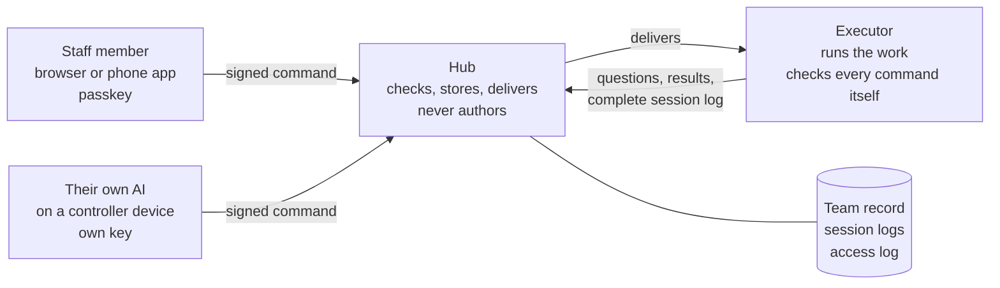
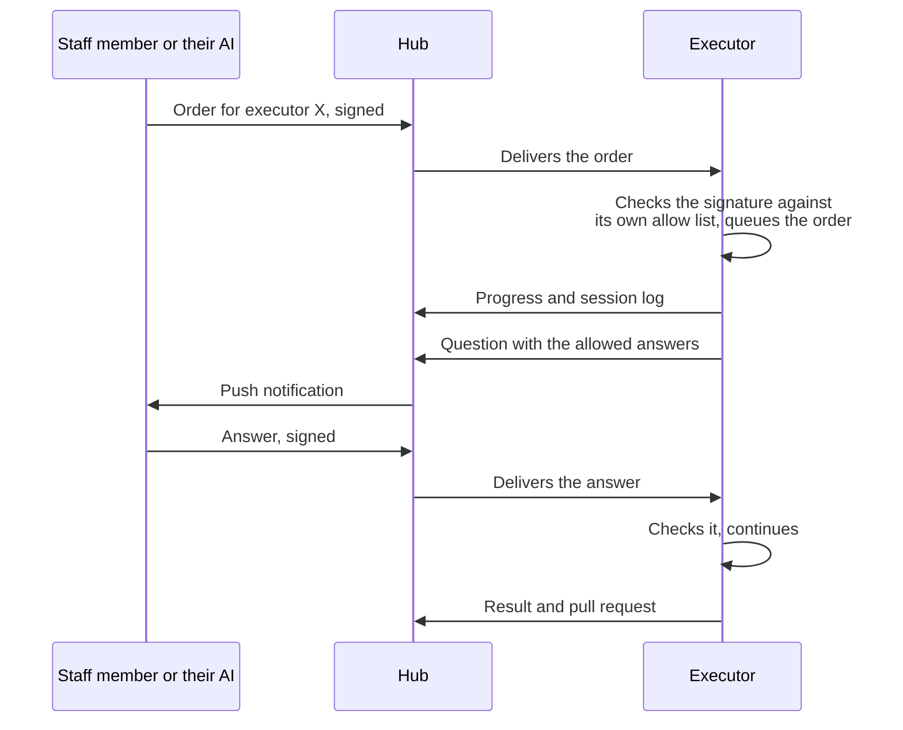
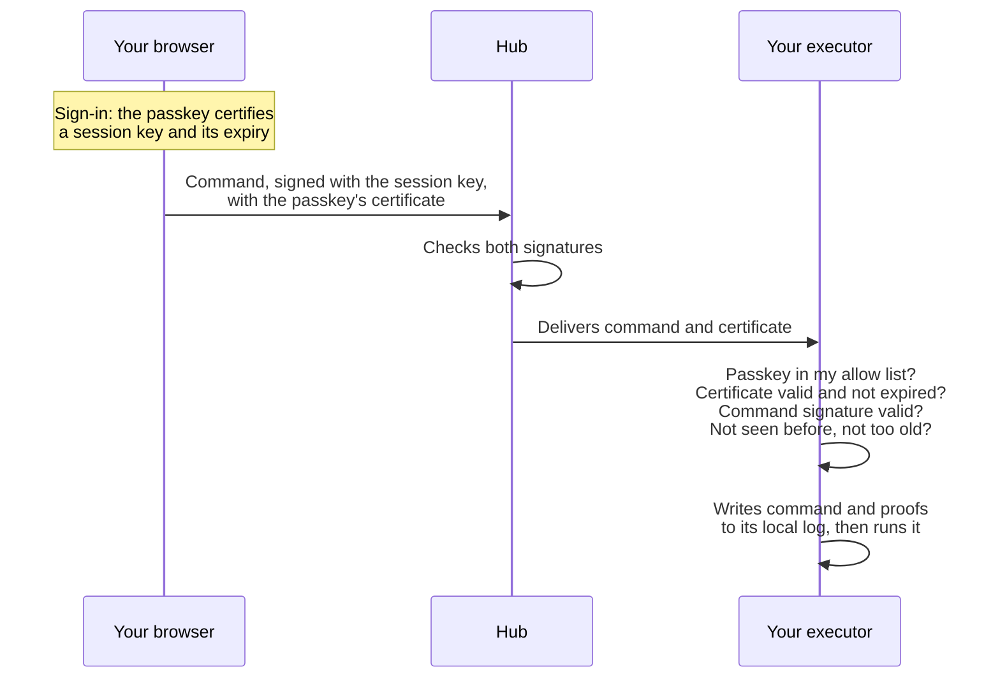

# Central operation

Central operation means: the whole team works through the hub. You connect a device once and
can then leave it alone. From the hub you hand work to it, answer its questions, watch every
running session and see what everyone on the team is doing.

**Status:** decided on 2026-11-17, not built yet. The binding rules are in
[DESIGN.md §25](../DESIGN.md#25-central-operation-decided-not-implemented). This page explains
them. If the two ever disagree, DESIGN.md wins and this page is fixed. The keys, the signed
history and the rule that nothing is deleted are explained in [team-record.md](team-record.md).

## Contents

1. [Why](#1-why)
2. [The idea in one picture](#2-the-idea-in-one-picture)
3. [Devices and their two levels](#3-devices-and-their-two-levels)
4. [Who may do what](#4-who-may-do-what)
5. [Handing work over](#5-handing-work-over)
6. [Why a device believes a command](#6-why-a-device-believes-a-command)
7. [Tasks and the team log](#7-tasks-and-the-team-log)
8. [What is recorded](#8-what-is-recorded)
9. [Watching and steering a session](#9-watching-and-steering-a-session)
10. [The overview](#10-the-overview)
11. [AI accounts and usage](#11-ai-accounts-and-usage)
12. [People and AI use the same interface](#12-people-and-ai-use-the-same-interface)
13. [The phone app](#13-the-phone-app)
14. [Joining, leaving and loss](#14-joining-leaving-and-loss)
15. [What stays refused](#15-what-stays-refused)
16. [Build order and status](#16-build-order-and-status)
17. [Glossary](#17-glossary)
18. [Questions people ask](#18-questions-people-ask)

## 1. Why

Today the pieces are spread out:

- Work is handed to a machine by logging in to that machine.
- Tasks live in issues on the code host, in a planning tool and in lists inside repositories.
- To see what a session is doing, you have to be at its terminal.
- Nobody has one place that shows tasks, pull requests, running sessions and AI usage together.

Central operation puts all of that in the hub, with one rule on top: whatever was commanded
can always be reconstructed.

## 2. The idea in one picture

Three things matter in this picture:

- **The hub delivers, it does not decide.** It never invents work and never picks a device.
- **The executor checks every command itself.** It does not trust the hub's word.
- **Everything flows back.** What a session shows and receives is recorded on the device and
  synced completely.

## 3. Devices and their two levels

The hub's counterpart is a **device**, not a code-host account and not an AI model. A device
has its own key, created on it and never leaving it. Every device belongs to exactly one staff
member, its owner.

| Level | What it is for | May do |
|---|---|---|
| Executor | A work machine that sits in a corner and runs | Runs work it was given. Cannot give work to anyone. |
| Controller | The machine you sit at | Everything an executor may do, and gives work to your executors |

A device tells the hub what it has: which AI accounts and subscriptions are set up on it, which
code-host accounts it can act as, and which runtimes it offers. It reports names and states
only, never a password or token.

Devices always connect outward to the hub. No device opens a port.

## 4. Who may do what

| You | On your own devices | On a colleague's device |
|---|---|---|
| Read: tasks, sessions in full detail, logs, usage | Yes | Yes |
| Write: submit orders, answer questions, type into a session, start and stop | Yes, without restriction | Only with a grant your colleague signed |

Everyone can see what everyone else is working on. Nobody can interfere with a colleague's
device unless that colleague allowed exactly that.

## 5. Handing work over

A **task** says what has to be done. An **order** is one attempt to do it on one executor.

- Orders on one executor run one after another.
- When several answers arrive, the first valid one wins.
- If the hub is unreachable, the executor keeps working on what it accepted and keeps
  recording. Everything is synced afterwards without a gap.
- Handing over is the normal way and stays voluntary. A session on your controller may do the
  work itself.
- Logging in to an executor directly stays possible as an override. It is recorded like
  everything else (section 8).

## 6. Why a device believes a command

A device obeys a command only when it has checked the proof itself. This is the same idea as
SSH: the machine holds a list of public keys it accepts, and nothing else gets in.

**The allow list.** Every device has one local file that lists every public key it obeys, what
that key may do and until when. A key that is not in the file can do nothing on the device,
whatever the hub says. An entry is added only by a statement signed with a key of the owner
that is already in the file, or by hand on the device.

**Signing in.** You sign in with your passkey, confirmed by fingerprint, face or PIN. That is
the only time you are asked. Your browser then creates a session key that cannot be copied out
of the browser, and your passkey certifies it. The session key signs what you do for at most
one working day.

**A grant** is how a colleague allows you something on their device. They sign a statement:
which key, which device, what exactly, for which repositories, until when. Their device checks
it and writes it into its allow list. A grant always expires and can be removed earlier.

**Taking a key away.** A revoked key is refused by the hub at once, and the hub tells every
device to stop obeying it. On the hub's word a device may obey less, never more.

**What this protects against.** Someone who takes over the hub can delay, drop or read
commands. They cannot create a command that any device accepts.

**What stays a risk.** The website's code is delivered by the hub. A hub that was taken over
could show you one command and sign another while you are signed in. The session key's short
life and a published hash of the website reduce that risk. They do not remove it. A command
can always be issued from a controller device instead, whose program does not come from the
hub.

## 7. Tasks and the team log

Every piece of work the team wants done is a **task** in the hub. Issues on the code host, the
planning tool and the lists in repositories are retired after a one-time import.

A task has a title, a description, a kind, an assignee, an urgency from 1 to 10, a status, and
a reference to the organisation and repository it belongs to. The reference may be empty when
the work has no clear home.

| Status | Meaning |
|---|---|
| to do | Not started. Without an assignee it shows as unassigned. |
| in progress | Someone works on it. Without activity for 60 minutes it shows as stalled. |
| ready for review | A pull request waits for review. |
| merged | Merged, waiting for the check in production. Only for tasks that need that check. |
| done | Finished. |
| closed | Ended without being done. |

**When is a task done?** Normally when its pull requests are merged into the default branch. A
security issue is done only after a staff member has also confirmed that the change is rolled
out to production and was checked there. The rule can be changed per task.

The **team log** is for things everyone should know. An entry is written once and never
edited; a correction is a new entry.

Where an organisation's repositories are hosted, on a public code host or on a git server the
team runs itself, is written down once in one file. Moving an organisation is one change
there.

## 8. What is recorded

| Store | Holds | Rule |
|---|---|---|
| Team record | Tasks, log entries, orders, questions, answers, grants, every command | Signed, chained, never deleted, no secrets and no personal data |
| Session log | Everything a session shows and receives | Recorded on the device first, synced completely, never deleted |
| Access log | Every request to the hub, including every page view | Written by the hub |

- A command that cannot be recorded is not executed.
- **Executors hide nothing.** Every AI session on an executor runs inside this system and is
  recorded in full. Direct logins to an executor are recorded too.
- **Your controller may work outside.** You may start an AI session on your controller that
  does not use this system. It is then not recorded and not visible.
- A session log can contain a password or a name that appeared on the screen by mistake. Such
  a value may be **masked** afterwards. Who masked what, when and why is recorded. A command,
  an answer or a decision can never be masked.

## 9. Watching and steering a session

In the hub you pick a staff member, then a device, then a session. You see it in the same
detail as at the terminal of that device: the full history and the live stream.

If the device is yours, or you hold a grant for it, you can type into the session and answer
questions that pop up. Otherwise you watch.

## 10. The overview

The start page shows the whole team at once:

- **Tasks:** done, merged and waiting for the check in production, in progress, stalled for 60
  minutes, ready for review, to do, unassigned.
- **Pull requests:** draft, ready for review, merged, closed. They are read from the code host.
- **Devices:** connected, working, idle. **Sessions:** working, waiting for an answer, idle.
- **AI usage:** tokens and cost per device, per account and per day.
- **Device health:** processor, memory and disk, read from the team's metrics system.
- **Server key figures:** for example the number of error log lines in the last 60 minutes,
  read from the team's infrastructure monitoring.

Every number opens down to the single task, session or event. Values from other systems are
shown with the time they were fetched; the hub only reads them.

## 11. AI accounts and usage

AI accounts and subscriptions are assigned to devices. The hub shows what each device uses.

The team also holds one central account at a model broker. The hub can create a key per device
with a spending limit, lower the limit and disable the key. It cannot call a model itself. The
model traffic goes from the device straight to the broker, so a hub outage stops no session.

## 12. People and AI use the same interface

Every function is one operation of one documented API. The website and the phone app are
clients of that API. Nothing exists only in the website and nothing only in the API; a test
fails the build otherwise.

Your own AI uses the same API with its own key on your controller. Whatever it does is
recorded under that key.

## 13. The phone app

The website can be installed on a phone as an app. It notifies you when a session has a
question or an order ends, and you answer with a tap.

Notifications use standard Web Push. The phone maker's push service transports them; they are
encrypted for your browser, so the push service cannot read them. When you answer on one
device, the notification disappears on your others, where the phone allows it. Notifications
keep arriving after your sign-in has expired; to answer, you sign in.

## 14. Joining, leaving and loss

| Event | What happens |
|---|---|
| You join | Your passkeys are added by pull request. You connect your devices and confirm each with a passkey. |
| You add a device | A new key is created on it and added by pull request. You confirm on the device. |
| You leave | Your keys are revoked by pull request, and every device stops obeying them. Your devices are retired or connected again for a new owner. What you signed stays valid and attributed to you. |
| A device is lost | Its key is revoked and its broker key disabled. Its history stays in the hub. |
| A passkey is lost | A pull request revokes it, and your devices stop obeying it. You sign in with another passkey and remove it from your devices. |

## 15. What stays refused

- The hub inventing work, picking a device, or moving work from one device to another.
- A scheduler that matches work to machines.
- Merging by a program. A human merges.
- Opening a port on a device.
- A function that exists in only one front end.
- Model traffic passing through the hub.

## 16. Build order and status

Each step is its own pull request and follows the steps of the
[team record](team-record.md#13-build-order-and-status).

| Step | What | Status |
|---|---|---|
| 1 | Device keys with levels and inventory; the allow list on the device | not started |
| 2 | Sign-in session key; grants | not started |
| 3 | Tasks, log entries, repository registry, one-time import | not started |
| 4 | Orders and questions through the hub | not started |
| 5 | Session log, recording of direct logins, masking, full session view | not started |
| 6 | Overview | not started |
| 7 | Monitoring adapters | not started |
| 8 | Central broker account | not started |
| 9 | Phone app with push | not started |

## 17. Glossary

| Term | Meaning |
|---|---|
| **Hub** | The central service and its website |
| **Device** | One machine with the client installed and its own key |
| **Owner** | The staff member a device belongs to |
| **Executor** | A device that runs work it was given |
| **Controller** | A device that may also give work to executors |
| **Task** | What has to be done |
| **Order** | One attempt to do a task on one executor |
| **Question** | A decision a running session needs |
| **Command** | Any instruction to a device |
| **Allow list** | The file on a device that lists the keys it obeys |
| **Grant** | A signed permission by an owner for someone else's key |
| **Session key** | A short-lived key in your browser, certified by your passkey |
| **Session log** | The complete recording of one session |
| **Masking** | Replacing a mistakenly recorded value by a marker |

## 18. Questions people ask

**Do I have to hand every piece of work to an executor?**
No. It is the normal way, and it stays your choice.

**Can a colleague type into my session?**
Only if you signed a grant for exactly that. Everyone can watch.

**Can I still log in to my executor directly?**
Yes. It is recorded like everything else on an executor.

**Is everything I do on my laptop recorded?**
Only sessions that use this system. A session you start outside it on your controller is
neither recorded nor visible.

**How often do I confirm with my fingerprint?**
Once, when you sign in. The session key then lasts at most one working day.

**What if the hub is down?**
Executors keep working on what they accepted and keep recording. You can still submit work on
the device itself. Everything syncs afterwards.

**What if someone breaks into the hub?**
They can read, delay and drop. They cannot make any device do anything, because each device
checks every command against its own allow list.

**Where did the issues and the lists go?**
They were imported once. The old place points to the hub and is no longer edited.
