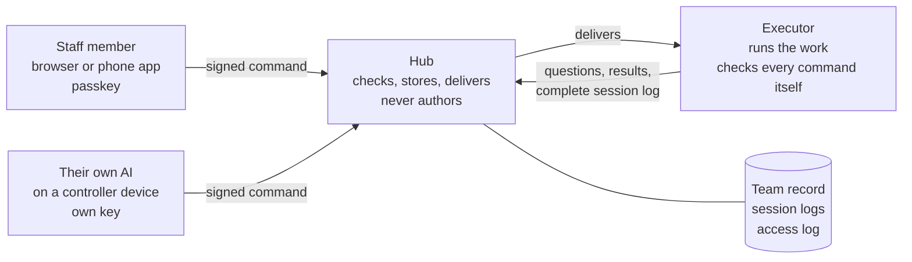
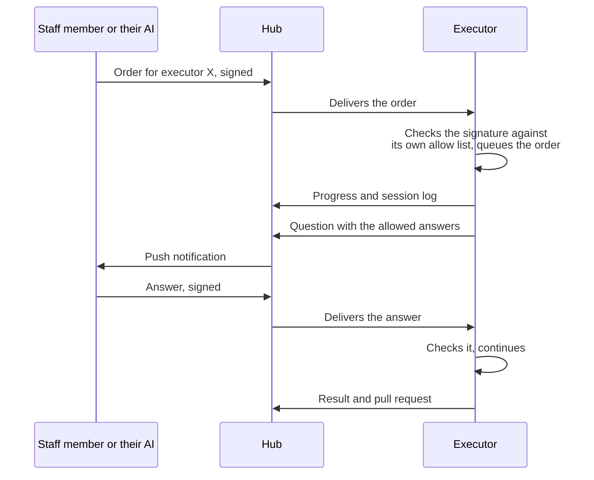
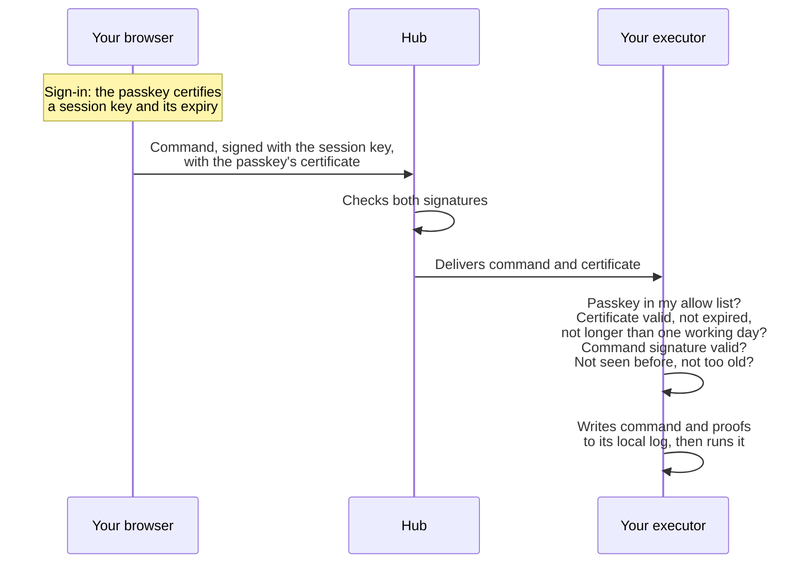

# Central operation

Central operation means: the whole team works through the hub. You connect a device once and
can then leave it alone. From the hub you hand work to it, answer its questions, watch every
running session and see what everyone on the team is doing.

**Status:** decided on 2026-11-17, not built yet. The binding rules are in
[DESIGN.md §25](../DESIGN.md#25-central-operation-decided-not-implemented). This page explains
them. If the two ever disagree, DESIGN.md wins and this page is fixed. The keys, the signed
history and the rule that nothing is deleted are explained in [team-record.md](team-record.md).

## Contents

1. [Why](#1-why)
2. [The idea in one picture](#2-the-idea-in-one-picture)
3. [Devices and their two levels](#3-devices-and-their-two-levels)
4. [Who may do what](#4-who-may-do-what)
5. [Handing work over](#5-handing-work-over)
6. [Why a device believes a command](#6-why-a-device-believes-a-command)
7. [Tasks and the team log](#7-tasks-and-the-team-log)
8. [What is recorded](#8-what-is-recorded)
9. [Watching and steering a session](#9-watching-and-steering-a-session)
10. [The overview and the device pages](#10-the-overview-and-the-device-pages)
11. [AI accounts and usage](#11-ai-accounts-and-usage)
12. [People and AI use the same interface](#12-people-and-ai-use-the-same-interface)
13. [The phone app](#13-the-phone-app)
14. [Joining, leaving and loss](#14-joining-leaving-and-loss)
15. [What stays refused](#15-what-stays-refused)
16. [Build order and status](#16-build-order-and-status)
17. [Glossary](#17-glossary)
18. [Questions people ask](#18-questions-people-ask)

## 1. Why

Today the pieces are spread out:

- Work is handed to a machine by logging in to that machine.
- Tasks live in issues on the code host, in a planning tool and in lists inside repositories.
- To see what a session is doing, you have to be at its terminal.
- A device's local dashboard can only be opened on that device.
- Nobody has one place that shows tasks, pull requests, running sessions and AI usage together.

Central operation puts all of that in the hub, with one rule on top: whatever was commanded,
by whom, on which target and when can always be reconstructed. Only a value masked by the
device's owner (section 8) is replaced by a marker.

## 2. The idea in one picture

Three things matter in this picture:

- **The hub delivers, it does not decide.** It never invents work and never picks a device.
- **The executor checks every command itself.** It does not trust the hub's word.
- **Everything flows back.** What a session shows and receives is recorded on the device and
  synced completely.

## 3. Devices and their two levels

The hub's counterpart is a **device**, not a code-host account and not an AI model. A device
has its own key, created on it and never leaving it. Every device belongs to exactly one staff
member, its owner.

| Level | What it is for | May do |
|---|---|---|
| Executor | A work machine that sits in a corner and runs | Runs work it was given. Cannot give work to anyone. |
| Controller | The machine you sit at | Everything an executor may do, and gives work to your executors |

Every device has a **device id**, the identifier it keeps in its `device.json`, and a **name**,
the one it has in the keys file. A device can have several entries there, its own key and one
per program key; every one of them carries the device id and the same name, owner and team.
The device id is how the check of the keys file tells which entries belong to one device. The
hub's **device list** shows every device by its name, and the device's page on the hub lives
at that path, for example `/example-device` (section 10). Because all teams on the hub share
these paths:

- A name is unique on the whole hub, over all teams, not only on your team. Two names that
  differ only in capital letters count as the same name.
- A name is never given to a second device, not even after the first one is retired. A
  retired device keeps its name and its page.
- A name is written in lowercase, has 1 to 63 characters from `a` to `z`, `0` to `9` and `-`,
  and begins with a letter or a digit.
- A name is never one of the paths the website itself uses, such as `api`, `auth`, `pair`,
  `sync`, the invite links or the website's own files. These are kept in one list in the hub's
  repository.

The check of the keys file fails a pull request that breaks one of these rules. It also fails
one in which entries with the same device id name different names, owners or teams, or in
which one device has two keys of its own that are not revoked, so a key of another person or
team cannot join your device by copying its name or its id. A pull request that adds a
website path that is already the name of a device fails as well.

The key of an external program, for example a guard on a CI runner, is not a device: it has
no device id, is not in the device list and has no device page.

A device tells the hub what it has, its **inventory**: which AI accounts and subscriptions are
set up on it, which code-host accounts it can act as, which runtimes it offers, and everything
else of its configuration and local state that its local dashboard shows and that is not in its
session store. It reports names, states and times only, never a password or token.

Devices always connect outward to the hub. No device opens a port.

## 4. Who may do what

| You | On your own devices | On a colleague's device |
|---|---|---|
| Read: tasks, sessions in full detail, logs, usage, device pages | Yes, row by row: a device page can leave out some rows, and a device that works under an agent's login only if you may see that login (below, section 10) | Yes, if you share a team, row by row (below) |
| Write: submit orders, answer questions, type into a session, start and stop, and every other action of the device page | Yes, without restriction | Only with a grant your colleague signed |

Everyone on your team can see what everyone else on it is working on. Nobody can interfere with a colleague's
device unless that colleague allowed exactly that.

"Your team" is checked for every single row, not for a whole page: you see a row only if you
share a team with the login it comes from and with every person it names. If you share only
one of a colleague's teams, their device page leaves out what comes from or names people of
their other teams (section 10).

A device run by an autonomous agent works under the agent's own login, not yours, even when
you own it. You read it, and its device page, only if you may see that login. You can still
send it work through the API (section 12).

## 5. Handing work over

A **task** says what has to be done. An **order** is one attempt to do it on one executor.

- Orders on one executor are queued per worker, as local orders are today.
- When several answers arrive, the executor accepts the first valid one and refuses the rest.
- If the hub is unreachable, the executor keeps working on what it accepted and keeps
  recording. Everything is synced afterwards without a gap.
- Handing over is the normal way and stays voluntary. A session on your controller may do the
  work itself.
- Logging in to an executor directly stays possible as an override. A login to the account
  that runs sessions is recorded like everything else; for an administrator login see
  section 8.

## 6. Why a device believes a command

A device obeys a command only when it has checked the proof itself. This is the same idea as
SSH: the machine holds a list of public keys it accepts, and nothing else gets in.

**The allow list.** Every device has one local file that lists every public key it obeys, what
that key may do and until when. A key that is not in the file can do nothing on the device,
whatever the hub says.

- The first entries are set by hand on the device, when you connect it: you confirm there the
  fingerprint of each key to be listed.
- Later, an entry is added, changed or removed only from one of your controller devices,
  signed with that device's key after you confirmed it there, or by hand on the device. The
  website can ask for such a change; it cannot make it.
- Sessions, orders and direct logins run under a different system account and cannot read or
  change the allow list, the device's key or the key of your own AI. Your AI gets its
  signatures from a small local service that signs for nothing else.
- If one of your controller keys is revoked, your devices also suspend everything that key
  signed, until you confirm it again.

**Signing in.** You sign in with your passkey, confirmed by fingerprint, face or PIN. That is
the only time you are asked. Your browser then creates a session key that cannot be copied out
of the browser, and your passkey certifies it. The session key signs what you do for at most
one working day.

**A grant** is how a colleague allows you something on their device. They sign a statement
from one of their controller devices: which key, which device, what exactly, for which
repositories, until when. Their device checks it and writes it into its allow list. A grant always expires and can be removed earlier.

**Taking a key away.** A revoked key is refused by the hub at once, and the hub tells every
device to stop obeying it. On the hub's word a device may obey less, never more.

**What this protects against.** Someone who takes over the hub can delay, drop or read
commands. They cannot create a command signed by a device key, and they cannot make a device
obey anyone new. With false notices that a key was revoked they can make a device obey less,
until you confirm the keys again.

**What stays a risk.** The website's code is delivered by the hub. A hub that was taken over
could show you one command and sign another while you sign in or are signed in, in your name.
A certificate obtained that way can be used for at most one working day, at a time the
attacker chooses, until your passkey is revoked; it never reaches an allow list. A passkey
created through an invite during a break-in can be the attacker's. After a break-in into the
hub, every passkey used or created during it is revoked, and the hub's own keys are replaced. The session key's
short life and a published hash of the website reduce the risk. They do not remove it. A command
can always be issued from a controller device instead, whose program does not come from the
hub.

## 7. Tasks and the team log

Every piece of work the team wants done is a **task** in the hub. Issues on the code host, the
planning tool and the lists in repositories are retired after a one-time import.

A task has a title, a description, a kind, an assignee, an urgency from 1 to 10, a status, and
a reference to the organisation and repository it belongs to. The reference may be empty when
the work has no clear home.

| Status | Meaning |
|---|---|
| to do | Not started. Without an assignee it shows as unassigned. |
| in progress | Someone works on it. Without activity for 60 minutes it shows as stalled. |
| ready for review | A pull request waits for review. |
| merged | Merged, waiting for the check in production. Only for tasks that need that check. |
| done | Finished. |
| closed | Ended without being done. |

**When is a task done?** Normally when every linked pull request is merged or closed and at
least one of them is merged into the default branch. A task without a pull request is set to
done by its assignee. A security issue, with or without a pull request, is done only after a staff member has also confirmed that the change is rolled
out to production and was checked there. The rule can be changed per task.

The **team log** is for things everyone should know. An entry is written once and never
edited; a correction is a new entry.

Where an organisation's repositories are hosted, on a public code host or on a git server the
team runs itself, is written down once in one file. Moving an organisation is one change
there.

## 8. What is recorded

| Store | Holds | Rule |
|---|---|---|
| Team record | Tasks, log entries, discussions, orders, questions, answers, grants and other changes of an allow list, maskings, every command | Signed, chained, never deleted, no secrets and no personal data |
| Session log | Everything a session shows and receives | Recorded on the device first, synced completely, never deleted; the only later change is masking |
| Access log | Every authenticated request to the hub, including every page view and every read | Written by the hub, append-only |

- A command that cannot be written to the device's local log is not executed.
- **Executors hide nothing.** Every AI session on an executor runs inside this system and is
  recorded in full. Direct logins to the account that runs sessions are recorded too. A local
  administrator login is not recorded as a session. The client writes a signed event for every
  change to the allow list, the device key or the recording software that it makes or notices.
  An administrator of a device can get around that and is trusted like its owner.
- **Your controller may work outside.** You may start an AI session on your controller that
  does not use this system. It is then not recorded and not visible.
- A session log can contain a password or a name that appeared on the screen by mistake. Such
  a value may be **masked** afterwards, also inside typed text, by the owner of the device
  that recorded it, confirmed on one of their controller devices. Who masked what, when and why
  is recorded. Who sent a command, an answer or a decision, to which target and when, and what
  was decided, can never be masked.

## 9. Watching and steering a session

In the hub you pick a staff member, then a device, then a session. You see it in the same
detail as at the terminal of that device: the full history and the live stream.

If the device is yours, or you hold a grant for it, you can type into the session and answer
questions that pop up. Otherwise you watch.

## 10. The overview and the device pages

The start page shows the whole team at once:

- **Tasks:** done, closed, merged and waiting for the check in production, in progress, stalled for 60
  minutes, ready for review, to do, unassigned.
- **Pull requests:** draft, ready for review, merged, closed. They are read from the code host.
- **Devices:** connected, working, idle. **Sessions:** working, waiting for an answer, idle.
- **AI usage:** tokens and cost per device, per account and per day.
- **Device health:** processor, memory and disk, read from the team's metrics system.
- **Server key figures:** for example the number of error log lines in the last 60 minutes,
  read from the team's infrastructure monitoring.

Every number opens down to the single task, session or event. Values from other systems are
shown with the time they were fetched; the hub only reads them. Every device in the overview
links to its device page.

**The device page.** `/<device name>` on the hub shows the same pages, the same sections, the
same tables and the same sub-pages as the local dashboard of that device (`agent dashboard`)
when you open it on the device itself, but every row only if you may see it (Reading, below).
If you are signed in under the login the device works under, which for your own laptop is
your login, you see what the local dashboard shows, apart from the few rows named below. For
`example-device`, the main page is `/example-device` and the Subscriptions page is
`/example-device/usage`. The full view of a session (section 9) is not part of the device
page; the page links to it.

- **The hub never asks the device.** It shows the page only from what it already holds for
  that device: the device's own records; the records of other devices that the hub delivered
  to it, that is session mail to its sessions, the pings its login sent or received, and what
  matched its subscriptions; and its inventory (section 3). Sync keeps these in step with the
  device. Whatever the local dashboard shows that the hub does not hold yet is added to the
  sync when the device pages are built (section 16).
- **It works when the device is off.** You then see the state of the last sync and when that
  was. Old data is never shown as current: a session that was working at the last sync shows
  as "working at the last sync", not as working now.
- **Reading** needs a sign-in with a passkey that may read. You can open the page of every
  device whose login shares a team with you; for a device run by an autonomous agent that is
  the agent's login, not its owner's. A device you may not see looks exactly like a device that
  does not exist. An AI or a program reads the same data only through the API, with its own key
  and only if that key may read; the key of an external program, for example on a CI runner,
  never reads it. On the page, every row is checked against your own teams: a session, a mail,
  a ping or a usage figure appears only if you share a team with the login it comes from and
  with every person it names. What you may not see is also left out of every count and sum,
  and the page does not say that something was left out.
- **What even the device's own login does not see there.** A colleague outside your teams may
  still send your session mail or a ping, and the local dashboard shows it. The device page
  leaves such a row out, also for you. After a change of the teams it also leaves out the rows
  you may no longer see.
- **Acting** is for the device's owner, and for a colleague only within a grant of the owner.
  Every action that a page of the local dashboard offers counts: submitting, acknowledging,
  answering, overriding, cancelling and marking orders done, and starting a session or an AI
  session, stopping it and typing into it. Changing the size of a terminal is not offered,
  because no page of the local dashboard offers it. An action on a row works only on a row of
  the device itself that you may see; submitting an order needs no row and works from the
  new-order page. An action from the page goes through the hub as a signed command, like an
  order, and the device checks it itself (section 6). The page never talks to the device
  directly, and it offers no action on a row that came from another device.
- **An action for a device that is off** waits at the hub. Until the device accepts or refuses
  it, the page shows it as not yet accepted or refused and says whether the hub has delivered
  it. The hub delivers it only within the device's time window for commands; after that the
  page shows it as not delivered, or as delivered without an answer, until the device's answer
  arrives with a later sync.

## 11. AI accounts and usage

AI accounts and subscriptions are assigned to devices. The hub shows what each device uses.

The team also holds one central account at a model broker. The hub can create a key per device
with a spending limit, lower the limit and disable the key. Its own key for that account cannot
call a model; it sees each device key once, when it creates it, and does not keep it. The
model traffic goes from the device straight to the broker, so a hub outage stops no session.

## 12. People and AI use the same interface

Every function is one operation of one documented API. The website and the phone app are
clients of that API. Nothing exists only in the website and nothing only in the API; a test
fails the build otherwise.

Your own AI uses the same API with its own key on your controller. Whatever it does is
recorded under that key. It reads device pages only through the API and only if its key may
read (section 10).

## 13. The phone app

The website can be installed on a phone as an app. It notifies you when a session has a
question or an order ends, and you answer with a tap.

Notifications use standard Web Push. The browser vendor's push service transports them; they are
encrypted for your browser, so the push service cannot read them. When you answer on one
device, the notification disappears on your others, where the phone allows it. Notifications
keep arriving after your sign-in has expired; to answer, you sign in.

## 14. Joining, leaving and loss

| Event | What happens |
|---|---|
| You join | The administrator sends you an invite link. You open it and create your passkey; it counts once its public key was added by pull request. Then you connect your devices. |
| You add a passkey | The administrator sends you an invite link for it, as for your first one. After its pull request you add it to the allow lists of your devices from a controller device. |
| You add a device | A new key is created on it and added by pull request. On the device you confirm the keys it will obey. |
| You leave | Your open orders are ended and your devices sync completely. Then your keys are revoked by pull request, and every device stops obeying them. Your devices are retired or connected again for a new owner. What you signed stays valid and attributed to you. |
| A device is lost | Its key is revoked and its broker key disabled. You end its open orders and withdraw their questions. Its history stays in the hub. |
| A device changes owner | It is connected again by hand as a new device with a new key, a new device id and a new name; the old key is revoked. |
| A passkey is lost | A pull request revokes it, and your devices stop obeying it. You remove it from your devices from a controller device. |

## 15. What stays refused

- The hub inventing work, picking a device, or moving work from one device to another.
- A scheduler that matches work to machines.
- Merging by a program. A human merges.
- Opening a port on a device.
- A function that exists in only one front end.
- Model traffic passing through the hub.

## 16. Build order and status

Each step is its own pull request and follows the steps of the
[team record](team-record.md#13-build-order-and-status).

| Step | What | Status |
|---|---|---|
| 1 | Device keys with levels and inventory; device ids, device names and their check; the allow list on the device | not started |
| 2 | Checking the session key's certificate on the device; grants | not started |
| 3 | Tasks, log entries, repository registry, one-time import | not started |
| 4 | Orders and questions through the hub | not started |
| 5 | Session log, recording of direct logins, masking, full session view | not started |
| 6 | Overview and device pages, with the sync of everything the local dashboard shows that the hub does not hold yet, and the check of every row against the reader's teams | not started |
| 7 | Monitoring adapters | not started |
| 8 | Central broker account | not started |
| 9 | Phone app with push | not started |

## 17. Glossary

| Term | Meaning |
|---|---|
| **Hub** | The central service and its website |
| **Device** | One machine with the client installed and its own key |
| **Device id** | The identifier of one device, carried by every keys-file entry of that device |
| **Device list** | The hub's list of every device, by name, with its owner and level; keys of external programs are not in it |
| **Device name** | The name of a device in the hub's device list, unique on the whole hub and never given to a second device; also the path of its device page |
| **Device's login** | The login a device works and syncs under; for a device run by an autonomous agent, the agent's own login |
| **Inventory** | What one device reports about itself: accounts, runtimes and the other values its local dashboard shows that are not in its session store |
| **Device page** | The page `/<device name>` on the hub that shows the pages of the device's local dashboard, every row only if the reader may see it |
| **Owner** | The staff member a device belongs to |
| **Executor** | A device that runs work it was given |
| **Controller** | A device that may also give work to executors |
| **Task** | What has to be done |
| **Order** | One attempt to do a task on one executor |
| **Question** | A decision a running session needs |
| **Command** | A signed instruction that reaches a device through the hub to act on a session or on work: an order, an answer, typed input, start, stop, and every action that a page of the local dashboard offers, triggered from a device page |
| **Allow list** | The file on a device that lists the keys it obeys |
| **Grant** | A signed permission by an owner for someone else's key |
| **Session key** | A short-lived key in your browser, certified by your passkey |
| **Session log** | The complete recording of one session |
| **Masking** | Replacing a mistakenly recorded value by a marker |

## 18. Questions people ask

**Do I have to hand every piece of work to an executor?**
No. It is the normal way, and it stays your choice.

**Can a colleague type into my session?**
Only if you signed a grant for exactly that. Everyone can watch.

**Can I still log in to my executor directly?**
Yes. A login to the account that runs sessions is recorded like everything else on an
executor. A local administrator login is not recorded as a session; an administrator of a device is
trusted like its owner (section 8).

**Is everything I do on my laptop recorded?**
Only sessions that use this system. A session you start outside it on your controller is
neither recorded nor visible.

**How often do I confirm with my fingerprint?**
Once, when you sign in. The session key then lasts at most one working day. Connecting a
device and changing its allow list are confirmed on a device, not with the passkey.

**Can I see my device's dashboard on the hub when the device is off?**
Yes, at `/<device name>`. It shows the state of the last sync and says when that was.

**Who sees my device page?**
Everyone who shares a team with the login your device works under, which for your own laptop
is your login. Each of them sees only the rows that come from and name people they share a
team with (section 10). Someone who shares no team with that login cannot tell that the page
exists. A program reads it only through the API with a key that may read.

**What if the hub is down?**
Executors keep working on what they accepted and keep recording. You can still submit work on
the device itself. Everything syncs afterwards.

**What if someone breaks into the hub?**
They can read, delay and drop, hold back or fake the notice that a key was revoked, and create
broker keys up to the limit of the central account. They cannot sign as a device and cannot
make a device obey anyone new. While you sign in or are signed in, a changed website could get
a session key certified in your name, usable for one working day at a time the attacker
chooses until your passkey is revoked (section 6, What stays a risk).

**Where did the issues and the lists go?**
They were imported once. The old place points to the hub and is no longer edited.
