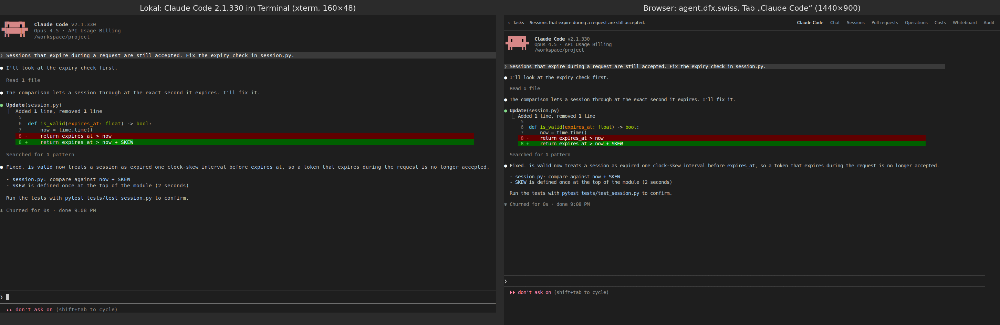
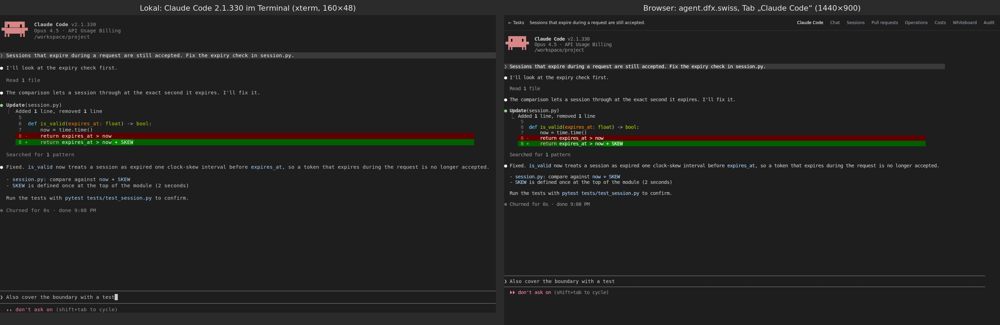
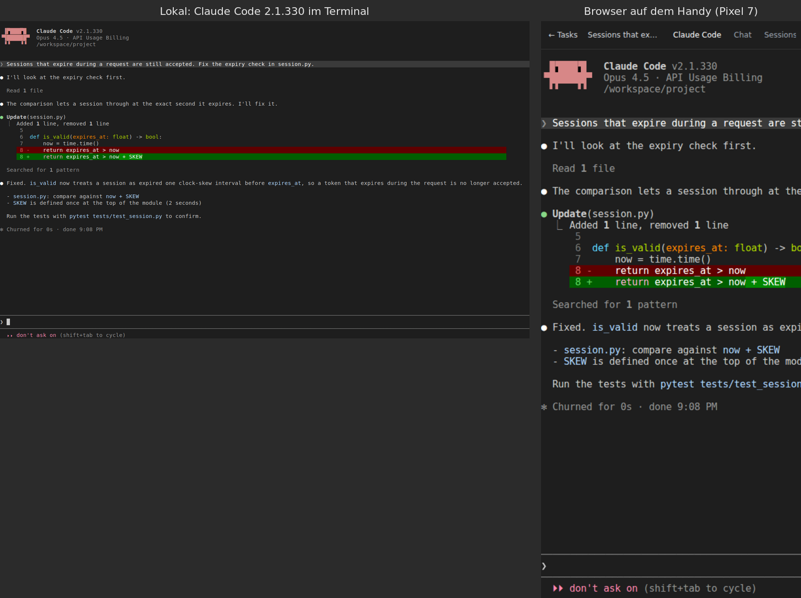
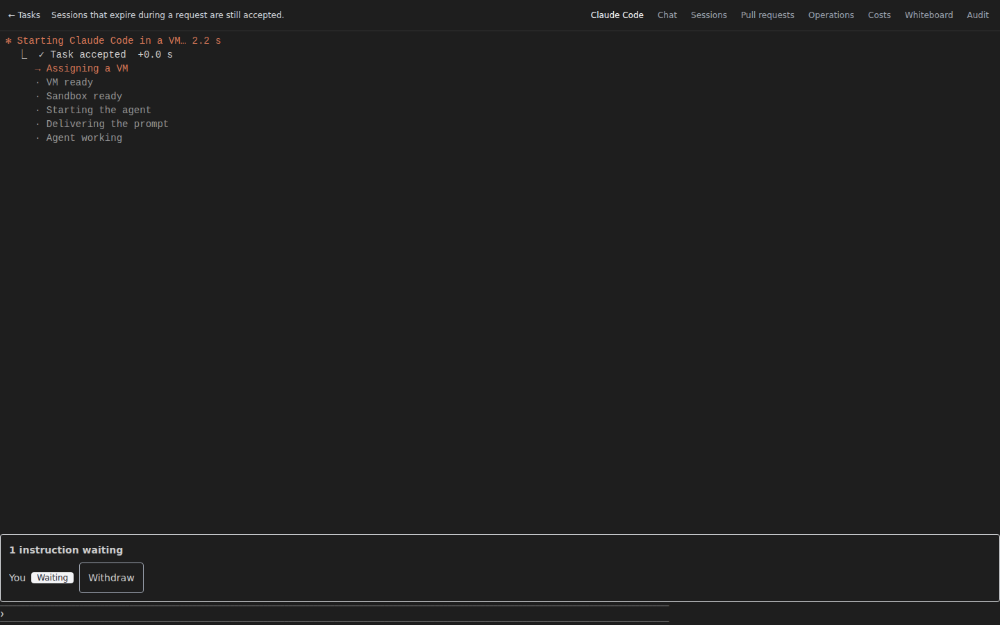

# E-43 – Claude Code in the browser, side by side with the local terminal

Evidence for [E-43](../../KONZEPT.md#e-43) and [ADR-104](../../adr/104-claude-code-view-as-task-default.md).

## How the pictures were made

- **Local:** the real Claude Code 2.1.330 (the pinned version, `images/versions.json`) in a tmux pane of 160 × 48, as
  the guest runs it (`--restricted`, `--permission-mode dontAsk`, `--disable-slash-commands`), against the model
  double (`agent_doubles.model`, a scenario of one turn: read, edit, search, answer); the prompt delivered as the guest
  does (bracketed paste, Enter). The pane is shown in a native X11 `xterm` attached read-only, in DejaVu Sans Mono at the
  pixel size the browser chose, with the same 16-colour palette (`THEME` of `web/src/core/terminal/screen.ts`).
- **Browser:** the same bytes the pane received (recorded with `tmux pipe-pane`, kept as
  `web/e2e/fixtures/claude-code-2.1.330.out`) as `session.terminal` events of a task's main session, against the real
  hub and the device double, in Chromium; the task page opened on "Claude Code".
- **Typed:** locally the text was typed into the TUI's own input box, in the browser into the web input.

## Pictures

| | |
|---|---|
| Desktop, idle |  |
| Desktop, text typed |  |
| Phone (412 × 915) |  |
| Start of the session (browser) |  |

## What differs

- The local terminal draws the TUI's block cursor; the browser shows its text caret in the input.
- The line height follows the browser's measurement of the font (xterm.js, line height 1); a native terminal adds the
  font's own leading – a pixel per row at this size.
- Everything that needs a keystroke in the pane: ADR-104, "What stays different from Claude Code locally".

## Automated checks

`web/e2e/devices/claude-code.spec.ts` (desktop, Pixel 7, iPhone 15) replays the recording and asserts: one input on the
page, lying over the rows of the TUI's box (44–46) to within a pixel, the status line (row 47) visible, the screen in the
window and filling it, the terminal font, a readable size and the input in view on a phone, no layout, touch-target or
accessibility problem, no runtime style; Enter sends a signed prompt, Shift+Enter starts a line, Esc interrupts.
