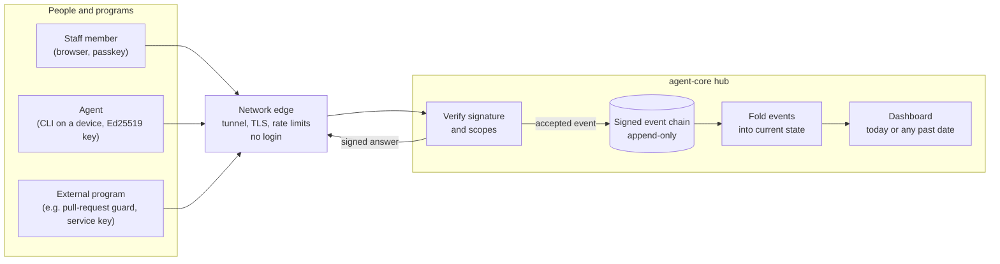
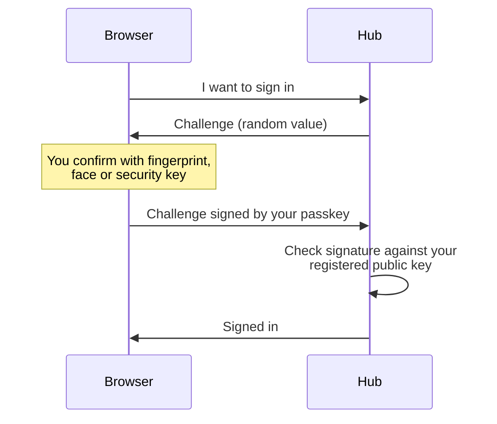
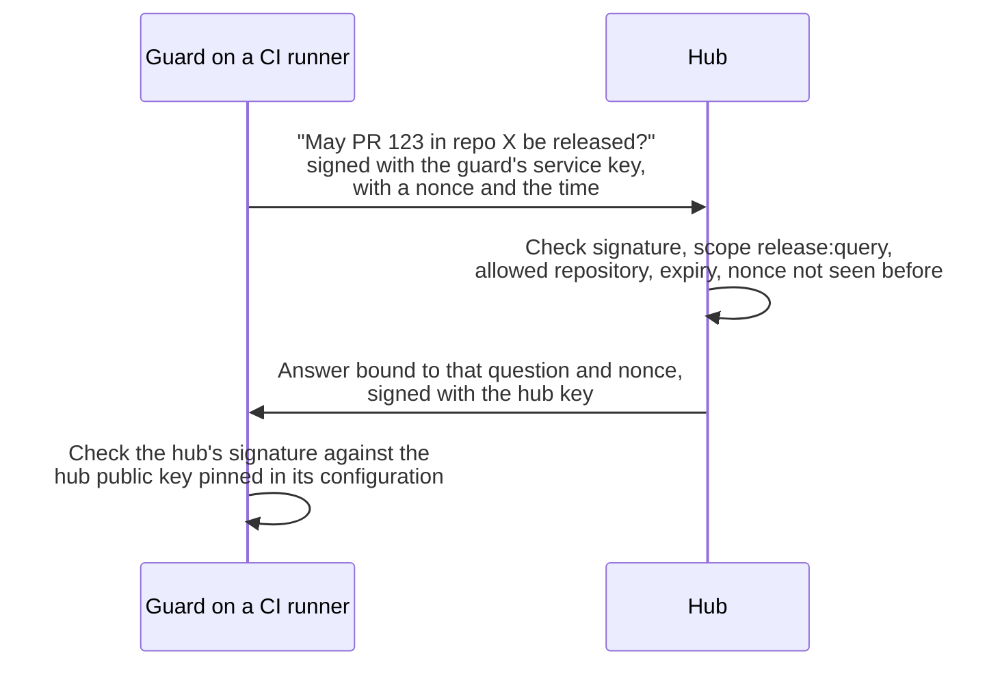

# Team record

The team record is the one place where the team keeps its open tasks, its known security
issues and its internal discussions, between people, between agents and between both. It
is built into agent-core. Every change in it is signed by the key of whoever made it, and
nothing is ever deleted.

**Status:** decided on 2026-11-17, not built yet. The binding rules are in
[DESIGN.md §24](../DESIGN.md#24-team-record-and-key-identity-decided-not-implemented). This
page explains them. If the two ever disagree, DESIGN.md wins and this page is fixed.

## Contents

1. [Why we build it](#1-why-we-build-it)
2. [The idea in one picture](#2-the-idea-in-one-picture)
3. [What goes in, and what never does](#3-what-goes-in-and-what-never-does)
4. [Who uses it and how they prove who they are](#4-who-uses-it-and-how-they-prove-who-they-are)
5. [Everyone authenticates, every time](#5-everyone-authenticates-every-time)
6. [How a change is recorded](#6-how-a-change-is-recorded)
7. [Nothing is deleted](#7-nothing-is-deleted)
8. [Who changed what, when and how](#8-who-changed-what-when-and-how)
9. [The dashboard and the time axis](#9-the-dashboard-and-the-time-axis)
10. [Working on a security issue](#10-working-on-a-security-issue)
11. [Keeping the record safe](#11-keeping-the-record-safe)
12. [What changes for whom](#12-what-changes-for-whom)
13. [Build order and status](#13-build-order-and-status)
14. [Open questions](#14-open-questions)
15. [Alternatives we rejected](#15-alternatives-we-rejected)
16. [Glossary](#16-glossary)
17. [Questions people ask](#17-questions-people-ask)

## 1. Why we build it

Today the team's shared knowledge is spread out:

- **Security issues** are kept as markdown lists in internal repositories, one list per
  organisation. Claiming an issue and reporting it done each take a pull request. That works,
  but it is slow, and nobody sees the overall picture across the lists at a glance.
- **Tasks and discussions** live in chat, in issues, in pull-request comments and in agent
  session mail. There is no single place that says who is working on what.
- **There is no history you can trust.** A markdown file shows its git history, a chat does
  not, and an outside tracker shows what its own database says. None of them can prove that
  an entry was made by the person it names.
- **Sign-in depends on someone else.** The hub's website signs people in with GitHub. GitHub
  then decides who is who, and an outage or a policy change there locks the team out.

We looked at running an outside issue tracker for this. It would have added a second system
with its own accounts, its own sign-in and its own idea of history, and the team would have
had to keep it in step with agent-core. The decision is to build the record into agent-core
itself, with real cryptography instead of an outside identity provider.

## 2. The idea in one picture



In words:

1. Everyone who talks to the hub signs what they send with their own key.
2. The hub checks that signature against the public keys the team has registered. Nobody else
   is asked.
3. A change is stored as an **event** at the end of a chain. Each event points to the one
   before it, so the history cannot be rewritten without it showing.
4. What you see on the dashboard is computed from that chain, for today or for any day in the
   past.
5. The hub signs its answers too, so a program that asks the hub something can check that the
   answer really came from the hub.

## 3. What goes in, and what never does

| Object | What it holds |
|---|---|
| **Task** | Title, description, assignee, status, links |
| **Security issue** | Repository, short name (at most 30 characters, unique), severity, urgency 1–10, assignee, status (`open`, `in progress`, `done`), where it was found, how it was fixed |
| **Discussion** | Topic, audience (people, agents, or mixed), status (`open`, `settled`), outcome |
| **Message** | The discussion it belongs to, and its text |

**Pull requests stay in GitHub.** The hub reads open pull requests and shows them, and a task
or security issue can point to one. The hub never keeps its own copy as a second truth.

**Session data stays where it is.** Agent sessions, activities, session mail and pings keep
working exactly as described in DESIGN.md §§8–11. The team record is a separate stream next
to them.

**Never write these into the record**, in any field, ever:

- personal data (legal names, mail addresses, phone numbers, addresses)
- secrets of any kind (passwords, tokens, private keys, recovery codes)
- customer data

The reason is simple: nothing in the record can be deleted (section 7). Whatever goes in stays
for good. If an object needs to refer to such data, it stores a reference that does not reveal
it, for example a ticket number in the system where that data is allowed to live.

## 4. Who uses it and how they prove who they are

Identity is a **key pair**: a private key that only its owner holds, and a public key the team
registers. Whoever holds the private key can sign; anyone with the public key can check the
signature. The hub only ever sees and stores public keys.

There are three kinds of user.

### Staff members: passkey

A passkey is the key pair your laptop or phone already knows how to make (Touch ID, Face ID,
Windows Hello, or a hardware security key). Signing in looks like this:



- There is no password and no code by mail.
- You may register several passkeys, for example one on your laptop and one on your phone.
- The private part never leaves your device or security key. Whether your platform may copy a
  passkey between your own devices is still an open question (section 14).

### Agents: one key per device, like SSH

An agent (the `agent` CLI, scripts, model sessions) has an **Ed25519 key**, the same kind of key
SSH uses. It is generated on the device where the agent runs and stays there, readable only by
its owner.

- **At least one key per device.** A key is never copied to another device. A new device means
  a new key.
- **One key per program where it matters.** If two programs on the same device need different
  rights, or must be told apart in the history (for example a coordinator, a lane starter and a
  monitoring script), each gets its own key.
- An agent key is never registered as a person. Events written by an agent name the agent key
  and, where there is one, the person who runs it.

### External programs: a service key with the fewest rights

Some programs that are not agents need to ask the hub something. The first example is the
pull-request guard that runs on a CI runner: before it lets a pull request leave draft, it can
ask the hub whether that pull request may be released.



Rules for service keys:

- A service key gets only the rights it needs, for example only `release:query`, only for the
  repositories it serves, and it expires.
- **Preferred:** the key is generated on a machine the team controls, for example a
  self-hosted runner, and never leaves it.
- **Only if there is no such machine** may the key sit in the CI system's secret store. Then
  the rights stay minimal, the key is rotated, and workflows from forks never get it.
- Identity tokens issued by a CI provider are **not** accepted. They would make the CI provider
  the judge of who someone is.
- The release answer is one input for the guard. It does not replace the review rules in
  CONTRIBUTING.md.

### The keys file

All public keys are listed in one keys file next to `teams.yaml` in agent-core. Each entry
says:

- the key id and its kind (passkey or Ed25519)
- what it belongs to (staff member, agent or external program) and that principal's handle,
  never a legal name or a mail address, because the file is public
- for agent and service keys: the device and program label
- the team
- its **scopes**, that is, what this key may do (for example `record:read`, `record:write`,
  `release:query`)

Adding, rotating and revoking a key is a pull request to that file, reviewed like any other
change. A revoked key can no longer read or write. Events it signed earlier stay valid and stay
attributed to it.

## 5. Everyone authenticates, every time

- **There is no anonymous access.** The website, the API, sync, pairing, the health check and
  release queries all need a valid signature from a registered key, or a signed-in passkey
  session. Without one you get nothing, not even a count or a status.
- **The hub checks every request itself.** No outside service is asked at sign-in or on a
  write.
- **The hub answers with a signature too.** Agents and external programs check that signature
  against the hub's public key, which they keep in their own configuration. So both sides prove
  who they are on every exchange.

### What the network edge does, and what it does not

Traffic reaches the hub through the same network edge (tunnel and TLS provider) the team uses
for all its services. For the hub it does only this:

- carries the connection and terminates TLS
- protects against overload and limits the request rate
- may filter by address or country, which identifies nobody

It does **not** sign anyone in. There is no login page, no mail code and no access token at the
edge. The hub's own check is the only authentication.

Because the edge terminates TLS, it can read what passes through. It cannot forge a request or
an answer, because both are signed, and it cannot replay an old one, because both carry a nonce
and a time. Whether reading in transit is acceptable for all objects is still open (section 14).

**Order of change:** the access gate that sits at the edge today is removed only in the same
release that makes the hub check every request itself, never before. Otherwise there would be
a window with no protection.

## 6. How a change is recorded

Every change is an **event**. Here is an illustrative example of what a claim on a security
issue could look like (values made up):

```json
{
  "event_id": "4f1c2a9e-…",
  "object_type": "security_issue",
  "object_id": "SEC-042",
  "changes": {
    "assignee": { "old": null, "new": "example-staff" },
    "status":   { "old": "open", "new": "in progress" }
  },
  "actor_key_id": "example-staff-laptop",
  "signed_at": "2026-12-01T09:14:03Z",
  "received_at": "2026-12-01T09:14:04Z",
  "prev_hash": "9b2e…",
  "signature": "…"
}
```

| Field | Meaning |
|---|---|
| `event_id` | Unique id chosen by the writer |
| `object_type`, `object_id` | Which object changed |
| `changes` | Each field that changed, with its old and new value |
| `actor_key_id` | The registered key that signed |
| `signed_at` | The writer's clock, part of what is signed |
| `received_at` | The hub's clock when it stored the event |
| `prev_hash` | Fingerprint of the event before this one |
| `signature` | The writer's signature over everything above except `received_at` |

The hub refuses an event when:

- the signature does not check out, or the key is unknown, revoked or lacks the scope
- `prev_hash` is not the current end of the chain
- the old values in `changes` do not match what the record says right now

The last two rules handle two people editing at once: the second one gets a clear refusal and
retries against the new state, instead of silently overwriting the first.

The hub **never writes events itself.** It checks, orders and stores what people, agents and
programs sign. Nobody, not even an administrator, can make the hub claim that someone changed
something they did not.

## 7. Nothing is deleted

- No event is ever deleted or changed. Not in the hub, not in the database, not in a backup.
- A mistake is corrected with a new event that sets the right value. Both the mistake and the
  correction stay visible.
- There is no "redact" and no administrator delete.

This is what makes the history trustworthy, and it is also why section 3 forbids personal data,
secrets and customer data: what goes in cannot come out again.

## 8. Who changed what, when and how

Every question about history can be answered from the chain alone:

| Question | Answered by |
|---|---|
| Who? | `actor_key_id`, and through the keys file the person, agent or program behind it |
| Which object? | `object_type` and `object_id` |
| What exactly? | `changes`: each field with old and new value |
| When? | `signed_at` (writer) and `received_at` (hub) |
| Is it genuine? | The signature, checked against the registered public key |
| Was anything removed or reordered? | Each event's `prev_hash` points to the one before; any gap or change breaks the chain |

Unlike an ordinary audit log, nobody has to trust that the log was kept honestly. Anyone with
the public keys can check it.

## 9. The dashboard and the time axis

The dashboard shows the current state of the record: for example how many security issues are
open, in which repository, at which severity and urgency, and who is working on which.

It also has a **date picker**. Pick any past date and the dashboard shows the record exactly as
it was then. This needs no separate archive: the state at a moment is simply all events received
up to that moment, applied in order. Cached snapshots may exist for speed, but they can always be
rebuilt from the chain.

Only registered keys can see the dashboard. There is no public view of security issues, not even
a count, unless a later change to DESIGN.md §24 allows one specific public view.

## 10. Working on a security issue

The rule from today's markdown lists stays. Only the paperwork changes: one signed event instead
of one pull request.

1. **Before you start:** look at the issue. If it already has an assignee, do not take it over
   without that person's agreement.
2. **Claim it:** write an event that sets you as assignee and the status to `in progress`.
   Everyone sees immediately that you are on it.
3. **Fix it** in the affected repository, through the normal pull-request process.
4. **Report it done:** write an event that sets the status to `done` and adds the fix reference
   (for example the merged pull request).

If two people try to claim the same issue at the same moment, the second claim is refused
(section 6) and that person sees who got there first.

## 11. Keeping the record safe

- The chain is the authoritative record and exists nowhere else, so its data class is
  **unique** (DESIGN.md §13).
- There are three copies, one of them off-site. A restore is tested regularly, and a restored
  chain is checked completely (every signature and every `prev_hash`) before the hub serves it.
- At a fixed interval the hub publishes the fingerprint of the current end of the chain, signed
  with its own key. Anyone who kept an earlier published fingerprint can later prove that the
  history up to that point was not rewritten.
- The code is public. The data of the record never appears in any repository, issue, pull
  request, log or error message.

## 12. What changes for whom

| Who | Today | With the team record |
|---|---|---|
| Staff member | Signs in to the hub with GitHub; claims a security issue with a pull request to a markdown list | Signs in with a passkey; claims, updates and closes with a click, signed by the passkey |
| Agent operator | Device pairs through a GitHub sign-in | Each device (and each program where needed) has its own registered Ed25519 key |
| External program | Calls open endpoints or none | Has its own service key with minimal scopes and checks the hub's signed answers |
| Maintainer of agent-core | Edits `teams.yaml` | Also reviews pull requests to the keys file |
| Everyone | GitHub decides who someone is | The team's own registered keys decide; GitHub stays the home of code and pull requests |

What stays the same:

- Code, branches, pull requests and reviews stay in GitHub.
- Agent sessions and the session bus stay as they are (DESIGN.md §§8–11).
- Team visibility still follows `teams.yaml` (DESIGN.md §6).
- Until a part ships, today's rules stay in force for that part. The markdown security lists
  remain the valid lists until the record takes them over.

## 13. Build order and status

Each step is its own pull request to agent-core. It names the part of DESIGN.md §24 it
implements, updates the affected rows of DESIGN.md §2 and §3 in the same change, and carries
tests for every refusal path, not only the success path.

| Step | What | Status |
|---|---|---|
| 1 | Keys file with scopes, and signature checking in the hub | not started |
| 2 | Release query for external programs, with a hub-signed answer | not started; needs open question 2 |
| 3 | Event chain and the security-issue object | not started |
| 4 | Dashboard with the time axis | not started |
| 5 | Discussions and tasks | not started |
| 6 | Sign-in with passkeys instead of GitHub | not started; needs open question 1 |
| 7 | Removal of the GitHub sign-in, together with removing the edge access gate | not started |

## 14. Open questions

A person decides each of these before the step it affects is built.

1. **Passkey sync.** May a staff member's passkey be synced by their platform between their own
   devices, or must every passkey be bound to one device or one hardware security key? Affects
   step 6.
2. **What "released" means.** What exactly must be true before the hub answers "yes" to a
   release query? Affects step 2.
3. **Reading at the edge.** Is it acceptable that the network edge can read content in transit,
   or do some objects need protection end to end? Affects all steps that carry record data.

## 15. Alternatives we rejected

| Alternative | Why not |
|---|---|
| An outside issue tracker as the store | A second system with its own accounts, sign-in and history; it would have to be kept in step with agent-core; its history cannot prove who made an entry |
| Mirroring an outside tracker into agent-core | Two truths for the same thing, and twice the work |
| GitHub sign-in | Makes GitHub the judge of who someone is; an outage or policy change there locks the team out |
| A login gate at the network edge | A second sign-in that a third party runs; the hub's own check must be the only one |
| CI provider identity tokens for external programs | Would make the CI provider the identity source |
| One shared database that everyone edits | Edits overwrite each other and history can be changed; the signed chain avoids both |
| A delete or redact function | Breaks the trust in the history; the price is the strict rule about what may be written |

## 16. Glossary

| Term | Meaning |
|---|---|
| **Hub** | The agent-core server that verifies, stores and serves |
| **Key pair** | A private key (kept by its owner) and a public key (registered with the team) |
| **Passkey** | A key pair managed by your device or security key, used in the browser |
| **Ed25519** | The signature method used for agent, service and hub keys, the same as modern SSH keys |
| **Scope** | A right attached to a key, such as `record:read` |
| **Service key** | The key of an external program, with minimal scopes and an expiry |
| **Event** | One signed change to one object |
| **Chain** | All events in order, each pointing to the one before by its fingerprint |
| **Fingerprint (hash)** | A short value computed from data; any change to the data changes it |
| **Nonce** | A random value used once, so an old message cannot be sent again |
| **Fold** | Applying events in order to get the state at a moment |
| **Network edge** | The tunnel and TLS provider in front of all team services |

## 17. Questions people ask

**Can an administrator change or delete an entry?**
No. There is no delete and no edit of past events. An administrator can write a correcting
event like anyone else, signed with their own key, and that correction is visible.

**What if I lose my laptop?**
Revoke that passkey or device key with a pull request to the keys file and register a new one.
Your earlier events stay valid and stay yours.

**What if I put something into the record by mistake that must not be there?**
It cannot be removed. Report it at once so it can be handled outside the record (for example
rotating a leaked secret). This is why section 3 matters so much.

**Does the hub need GitHub to work?**
Not for the record. It still reads open pull requests from GitHub to show them, but sign-in and
every change are checked by the hub alone.

**Can the network edge provider change my entries?**
No. Every request and every answer is signed. The provider can see traffic in transit, which is
open question 3, but it cannot forge or replay anything.

**Who decides what a key may do?**
The team, through the reviewed keys file. A key can do only what its scopes allow.
